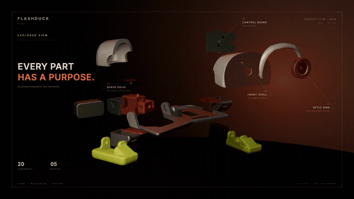
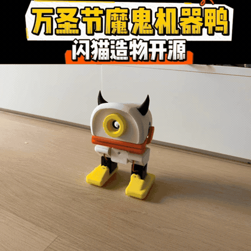
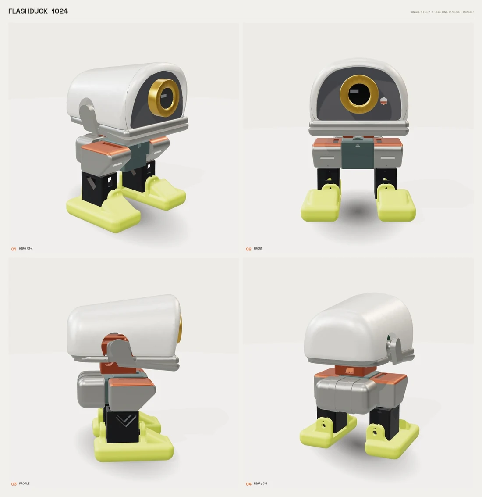
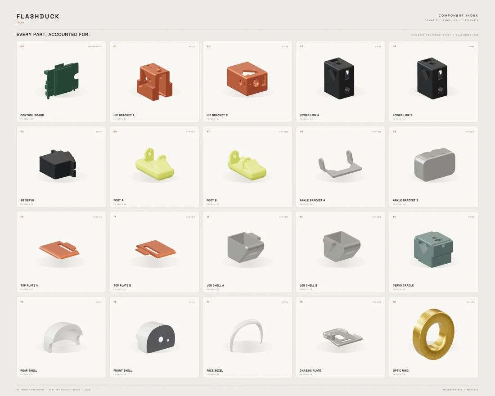

<p align="center">
  <b>中文</b> | <a href="README_EN.md">English</a>
</p>

<p align="center">
  
</p>

<p align="center">
  <sub>产品循环 · <a href="https://shanmaotech.cn/flashduck/">完整视频与组装指南</a></sub>
</p>

<h1 align="center">闪猫造物Flashduck</h1>

<p align="center">
  <b>一只会走路、会看人、会用眼神说话的桌面小鸭。</b><br>
  同一套六舵机硬件，换一副 3D 打印外壳，就从人形变成小鸭。
</p>

<p align="center">
  <b>会走、会看、会用眼神说话，还能让 AI 控制每一个关节。</b>
</p>

<p align="center">
  
  
  
  
  
</p>

<p align="center">
  <a href="#复刻流程四步"><b>复刻流程</b></a> ·
  <a href="#硬件与物料"><b>硬件</b></a> ·
  <a href="#编译与烧录"><b>编译烧录</b></a> ·
  <a href="#二次开发"><b>二次开发</b></a> ·
  <a href="llms.txt"><b>llms.txt</b></a>
</p>

---

## 项目介绍

Flashduck 是一只由 AI 完全自主控制的桌面机器鸭。它能通过摄像头察言观色，用嘎嘎声和语音回应你的情绪；一只小眼睛会跟着状态变化，用眼神和你互动；6 个自由度驱动脖子、嘴巴、双腿和双脚，做出灵动的姿态和动作。AI 直接控制 6 个关节，能组合出许多意料之外的动作与姿态。

闪猫科技基于闪猫1号（Otto AI 版）的全部电子元器件，重新设计了一套外壳结构，并配套了全新的固件方案。小白用户拿一套闪猫1号（Otto AI 版）DIY 套件就能把它造出来，不需要额外购买电子零部件；跟着教程，约 30 分钟就能拼起来。

闪猫科技还开源了配套的二次开发 Skill，能让 WorkBuddy、Codex、Claude Code 等 AI 助理快速完成二次开发。你只需要用自然语言描述需求，就能做出属于自己的 AI 硬件或桌面机器人。

项目正在持续更新中，未来还会上线更多玩法，比如一句话让 AI 做 3D 建模、改造外壳。快来打造属于你自己的小鸭子吧。

### 它不是一台“预设动作播放器”

Flashduck 想做的，不是一台“按一下播放一个动作”的机器鸭，而是一台由 AI 自主决定身体怎么动的机器鸭。

多数桌面机器人把动作写死在代码里：开发者先定义“挥手 = 角度 A → B → C”，用户只能触发已经存在的动作。

Flashduck 想走另一条路：**让 AI 真正控制身体，而不只是从动作列表里挑一个。**

DuckClaw 的 **Servo Sequences**（[`self.otto.pose`](firmware/duckclaw/spiffs_data/config/TOOLS.md)）把六个关节的角度直接开放给模型。AI 可以：

- 根据当前对话，现场组合一组姿势；
- 连续调用多个姿势，拼出一段没有写进代码的动作序列；
- 用身体即兴表达第一次出现的情绪、场景或玩笑，而不是退回固定动作表；
- 把腿、脚、脖子和嘴巴的角度当成“像素”，一点点拼出自己的想法。

这就是我们说的 **AI 思想的物理化**：模型不只是输出文字，还能决定身体怎么动。

基础动作仍然保留：走、转、跳、摇头、张嘴。它们像“词汇”，Servo Sequences 像“语法”；AI 可以用词汇说话，也可以临时造一个新句子。

| | 传统预设动作 | Flashduck |
|---|---|---|
| **新动作** | 改代码、重新烧录 | AI 在运行时组合关节角度 |
| **动作粒度** | 一个动作对应一个函数 | 六个关节，可拆、可组、可连续 |
| **表达来源** | 固定动作列表 | 对话、情绪、上下文；语音版还可结合视觉 |
| **扩展方式** | 开发者先定义完 | 模型 + MCP 工具 + Skill 继续生长 |

在 DuckClaw 模式里，模型可以自己决定下一步做什么动作，而不需要开发者先把每个动作写成函数。这也是 Flashduck 和其他桌面机器人最不一样的地方：**它的身体不是一段提前录好的动画，而是 AI 可以实时书写的输出通道。**

### 它怎么和你互动

**语音版**：你喊它 → 它看向你、听你说 → 回答 → 用眼神和动作回应 → 需要时调用工具。

**DuckClaw**：你在钉钉发消息 → 机器人内的 Agent 理解并规划 → 调用工具或生成回复 → 直接操控六舵机表达情绪和动作 → 记住这段交流。

两套系统二选一，刷哪套玩哪套。

### 几种玩法

- **桌面搭子**：聊天、问答、查资料，听它用声音回应；
- **语音指挥**：让它走两步、转个圈、跳一下、摇摇头、张张嘴；
- **看看世界**：装上摄像头，问“我手里拿的是什么”“前面是什么”；
- **安静陪伴**：不接语音，用钉钉找 DuckClaw；它不吵你，但会记得你；
- **二次开发**：改眼睛、编动作、调步态、换外壳，或者接自己的模型、工具和社交软件；
- **做一只自己的鸭**：打印外壳、换颜色、改结构，摆在桌上或带去聚会。

### 开放在哪里

- **两套交互系统**：语音版 + DuckClaw 端侧 Agent，同一副硬件，两种性格；
- **语音后端可选**：可以接 xiaozhi.me，也可以自己部署 xiaozhi-esp32-server；
- **端侧 Agent 可扩展**：DuckClaw 完全运行在机器人内部，可配置自己的模型，调用外部工具、连接钉钉等社交软件，并直接控制身体；
- **硬件可改**：基于官方六舵机套件，外壳可打印、结构可改；
- **软件可改**：语音固件是 MIT，DuckClaw 是 CC BY-NC-SA；动作、眼睛、工具和 Agent 都能继续长。

### 一套 AI 硬件的完整底座

从语音、视觉、显示、表情到动作和工具调用，市面上 AI 硬件产品常见的功能组件，它基本都具备。

Flashduck 把一台小型 AI 硬件常用的能力，集中在了同一副身体上：

- **语音**：麦克风 + 扬声器，唤醒、对话、语音反馈；
- **视觉**：可选摄像头，OV2640 / OV3660 / GC2145 自动识别；
- **显示与表情**：1.54 英寸屏幕，单眼表情系统；
- **动作**：六舵机，驱动双腿、双脚、脖子和嘴巴；
- **计算与连接**：ESP32-S3、Wi-Fi/蓝牙、可充电电池；
- **Agent 与工具**：MCP 工具链、端侧 Agent，可接自己的模型和服务。

所以它不只是“一只会走路的鸭子”，更像一块 **AI 硬件开发底座**。同一套核心能力可以迁移到：

- 二足机器人、四足机器狗；
- 桌面陪伴机器人、教育机器人；
- AI 录音卡、桌面语音助手；
- 带摄像头和表情的桌面 Agent；
- 任何需要“语音 + 视觉 + 屏幕 + 动作 + 工具调用”的小型 AI 硬件。

你可以只取其中一层：语音链路、视觉、动作、屏幕、Agent，或者把它们重新组合成自己的产品。它不是一个封闭成品，而是一套可以继续长大的 AI 硬件骨架；换形态、换传感器、换 Agent，都可以从这套底座长出来。硬件和代码都留了改造空间。

---

## 视频展示

<p align="center">
  <a href="firmware/voice/docs/videos/flashduck-demo.mp4">
    
  </a>
</p>

<p align="center">
  <sub>万圣节限定“恶魔鸭”外壳 · <a href="firmware/voice/docs/videos/flashduck-demo.mp4"><b>观看完整视频（30 秒，带声音）</b></a></sub>
</p>

---

## 两套交互系统

同一副硬件，可以刷两套完全不同的交互系统。**二选一，不能同时运行**；刷一套会覆盖另一套。

| 系统 | 目录 | 怎么玩 | 适合 |
|---|---|---|---|
| **语音交互版** | `firmware/voice/` | 喊“小鸭小鸭”，和它说话、让它做动作、调步态 | 想聊天、指挥动作、接工具 |
| **DuckClaw** | `firmware/duckclaw/` | 机器人内部的 Agent：钉钉交流、工具调用、情绪表达、直接控制身体 | 安静陪伴、远程互动、可扩展 Agent |

**语音版怎么玩：**

- 喊“小鸭小鸭”唤醒，直接说话；
- 让它走、转、跳、摇头、张嘴，或者做鸭子动作；
- 接 MCP 工具后，可以查天气、控制家电、搜索资料；
- 打开网页调步态，满意后保存，下次开机还记得；
- 眼睛会根据扫描、连接、待机、聆听、说话切换神态。

**DuckClaw 怎么玩：**

- 它是一套端侧 Agent：可调用外部工具、连接钉钉、直接控制身体；
- 不开口，通过钉钉发消息；
- 它会记住会话和长期记忆；
- 22 种情绪和关系成长，屏幕显示红心阶段；
- 大模型可以自主决定六个舵机的角度，做即兴姿势；
- 没有语音打断，适合安静桌面/陪伴场景。

详细说明：[`firmware/duckclaw/README.md`](firmware/duckclaw/README.md)。两套代码的许可证不同，见文末 License。

### 语音后端怎么选

`firmware/voice/` 的语音固件是**设备端客户端**，本身不包含云端大模型服务。你需要给它接一个后端，常见两种：

| 后端 | 适合 | 入口 |
|---|---|---|
| **xiaozhi.me** | 想最快跑通，用托管服务 | <https://xiaozhi.me> |
| **xiaozhi-esp32-server** | 想自己部署 ASR / LLM / TTS、管理后台和协议服务 | <https://github.com/xinnan-tech/xiaozhi-esp32-server> |

- `xiaozhi.me` 适合先验证硬件、语音链路和唤醒；
- `xiaozhi-esp32-server` 是开源自托管方案，部署方式、模型和协议以该仓库 README 为准；
- 设备端的 OTA 地址、WebSocket/MQTT 配置按你选的后端填写；
- **DuckClaw 是另一套端侧 Agent**：它不依赖这两个语音后端，Agent 运行时、记忆、工具调度和身体控制都在机器人内部完成；模型服务可自行配置，详见 [`firmware/duckclaw/README.md`](firmware/duckclaw/README.md)。

---

## 复刻流程（四步）

推荐顺序：**买套件 → 打外壳 → 烧固件 → 改代码/改外壳**。  
第一次做建议按顺序走；只想改软件，可以直接跳到第三步。

| 步骤 | 做什么 | 入口 |
|---|---|---|
| **01** | 购买 **官方六舵机 DIY 套件** | [淘宝官方店](https://m.tb.cn/h.j3SXw4qlVy1K4pl) · [组装指南](https://shanmaotech.cn/flashduck/) |
| **02** | 打印 **Flashduck 3D 外壳** | [MakerWorld 模型](https://makerworld.com.cn/models/3146116) |
| **03** | **编译并烧录** Flashduck 固件 | [跳到详细步骤](#编译与烧录) |
| **04** | **二次开发**：改眼睛、动作、步态或外壳 | [跳到二次开发](#二次开发) |

### 01 · 购买套件

Flashduck 不需要重新买一套电子件，它复用官方套件的六舵机、开发板、屏幕、摄像头、扬声器和电池。

- 六舵机套件：双腿、双脚、脖子、嘴巴；
- ESP32-S3 主控板，支持摄像头扩展；
- 1.54 英寸 240×240 屏幕；
- 摄像头可选，不装也能正常开机；
- 扬声器、麦克风、可充电锂电池、摇臂和螺丝包。

购买入口：[淘宝官方店](https://m.tb.cn/h.j3SXw4qlVy1K4pl)  
完整物料和装配说明：[官方组装指南](https://shanmaotech.cn/flashduck/)

### 02 · 打印外壳

Flashduck 的结构件是 **13 种、17 个零件**，包括头壳、额头、下巴、嘴巴、身体、大腿、小腿、脚、脖子和关节件。

- 下载模型：[MakerWorld · Flashduck](https://makerworld.com.cn/models/3146116)
- 不需要焊接，主要工作是打印、拧螺丝和装摇臂；
- 建议易损件（嘴巴、脚）一次多打几个；
- 官方原装外壳可以留着，随时换回去。

### 03 · 编译与烧录

需要 ESP-IDF **6.0.1+**、Python 3 和一根能传数据的 USB-C 线。

> 第一次用、或者不确定电脑环境？先跑 `bash skills/flashduck-dev/scripts/check-env.sh`。  
> macOS 上如果仓库路径含中文，ESP-IDF 可能报 `picolibc.specs`，请按 Skill 提示用 ASCII 路径构建。

```bash
git clone https://github.com/FlashCat-Jordan/Flashduck.git
cd Flashduck/firmware/voice
source ~/esp/esp-idf-v6.0.1/export.sh

python3 scripts/build.py flashduck \
  --name flashduck \
  --language zh-CN \
  --wake-word wn9_xiaoyaxiaoya_tts2

esptool --chip esp32s3 -p <PORT> -b 460800 \
  write_flash 0x0 build/merged-binary.bin
```

烧录后按一下复位键，按提示配网。详细说明见 [编译与烧录](#编译与烧录)。

> 想玩 **DuckClaw**：`cd firmware/duckclaw && idf.py set-target esp32s3 && idf.py build`，然后烧录。  
> 两套系统二选一，详见 [两套交互系统](#两套交互系统)。

### 04 · 二次开发

这套代码留了几个明确的改动入口：

- **眼睛**：新增状态、颜色、眼睑曲线；
- **动作**：注册新的 MCP 动作，复用现有步态基元；
- **步态**：网页调参写 NVS，或者直接改默认值；
- **感知**：摄像头可选，已支持自动识别，可接视觉/MCP 工具；
- **外壳**：13 个打印件都可以改，做鸭、鸟、企鹅或其他形态；
- **平台**：动作和语音接口分开，可以只取硬件层接自己的 Agent。

详细入口见 [二次开发](#二次开发)。

---

<p align="center">
  📺 <b>视频号：闪猫君</b> ｜ <b>公众号：闪猫科技、闪猫造物</b>
</p>

<p align="center">
  <a href="https://weixin.qq.com/sph/AiKMEP9dte">
    
  </a>
  &nbsp;&nbsp;&nbsp;
  <a href="https://mp.weixin.qq.com/s/PrkluvMILHDkG7QTqRdu6A">
    
  </a>
</p>

<p align="center">
  <sub>扫码关注 · 二维码来自 <a href="https://shanmaotech.cn">shanmaotech.cn</a></sub>
</p>

---

## 硬件与物料

| 项目 | 规格 |
|---|---|
| 主控 | ESP32-S3，16MB Flash（以实际板卡为准） |
| 舵机 | 6 × MG90 系列离合舵机 |
| 屏幕 | 1.54 英寸 ST7789，240 × 240 |
| 摄像头 | 可选：OV2640 / OV3660 / GC2145 |
| 音频 | I2S 麦克风 + I2S 扬声器 |
| 供电 | 可充电锂电池，支持充电状态检测 |
| 结构 | 13 种、17 个 3D 打印件 |
| 装配 | 无需焊接；打印件 + 螺丝 + 摇臂 |
| 网络 | Wi-Fi 2.4GHz |

### 六个舵机

| 关节 | 功能 | GPIO |
|---|---|---|
| 脖子 | 左右转头 | `GPIO7` |
| 嘴巴 | 开合 | `GPIO4` |
| 左腿 | 前后摆 | `GPIO5` |
| 左脚 | 抬脚 | `GPIO6` |
| 右腿 | 前后摆 | `GPIO43` |
| 右脚 | 抬脚 | `GPIO44` |

> 摄像头、屏幕、音频和电源使用官方 CAM 板的既有引脚；摄像头不插时，固件会自动跳过初始化。

<p align="center">
  
</p>

<p align="center">
  <sub>Flashduck 1024 · 四视图：正面、侧面、背面和 3/4 视角</sub>
</p>

### BOM 一览

| 物料 | 数量 |
|---|---|
| MG90 系列离合舵机 | 6 |
| ESP32-S3 主控板（支持摄像头扩展） | 1 |
| 1.54" ST7789 240×240 屏幕 | 1 |
| 摄像头模组（可选） | 0 / 1 |
| I2S 扬声器 + 麦克风 | 1 套 |
| 可充电锂电池 | 1 |
| 摇臂包、螺丝包、螺丝刀 | 1 套 |
| 3D 打印结构件 | 17 件 |

### 硬件资料

- 组装与使用指南：<https://shanmaotech.cn/flashduck/>
- 3D 模型：<https://makerworld.com.cn/models/3146116>

---

## 3D 打印与组装

<p align="center">
  
</p>

<p align="center">
  <sub>13 种结构件 + 6 个舵机 + 主控、屏幕、摄像头和电池</sub>
</p>

- 下载并打印 17 个结构件；
- 先装腿和脚，再装身体、脖子和头壳；
- 嘴巴和脚建议多打一套备件；
- 摄像头不装也能完成整机装配；
- 装好后先手动转动关节，确认没有卡壳，再上电。

完整步骤以官方组装指南为准：<https://shanmaotech.cn/flashduck/>

---

## 编译与烧录

### 环境

- ESP-IDF **6.0.1+**
- Python 3
- 一根能传数据的 USB-C 线
- macOS / Linux / Windows 均可

### 编译 Flashduck

```bash
git clone https://github.com/FlashCat-Jordan/Flashduck.git
cd Flashduck/firmware/voice

source ~/esp/esp-idf-v6.0.1/export.sh

python3 scripts/build.py flashduck \
  --name flashduck \
  --language zh-CN \
  --wake-word wn9_xiaoyaxiaoya_tts2
```

### 编译 DuckClaw（第二套系统）

```bash
cd firmware/duckclaw
idf.py set-target esp32s3
idf.py build
idf.py -p <PORT> flash
```

DuckClaw 使用独立的 `firmware/duckclaw/partitions.csv` 和 `firmware/duckclaw/spiffs_data/`，不需要根目录的构建脚本。它与语音固件二选一，不能同时运行。

### 烧录完整镜像

编译完成后会生成 `build/merged-binary.bin`，包含 bootloader、分区表、app 和 assets：

```bash
# macOS 示例，端口按实际修改
esptool --chip esp32s3 \
  -p /dev/cu.usbmodem1101 \
  -b 460800 \
  write_flash 0x0 build/merged-binary.bin
```

Windows 把端口换成 `COMx`。烧录后按一下复位键。

> 如果只改了 app，也可以只烧 `0x20000` 的 app 镜像；  
> 如果换了唤醒词或提示音，必须同时烧 `0x800000` 的 `build/generated_assets.bin`，因为唤醒模型和音频都在 assets 分区里。

### 第一次开机

1. 按提示配网；
2. 串口日志里会打印设备 IP；
3. 浏览器打开 IP，先调一组你喜欢的步态；
4. 说 **“小鸭小鸭”** 唤醒；
5. 让它走两步。

---

## 单眼表情

眼睛是 Flashduck 最重要的“脸”。五种状态不是换一张图，而是换一套眼睑、瞳孔和扫视参数：

| 状态 | 眼神 | 颜色 |
|---|---|---|
| **扫描 Wi-Fi / 连接中** | 眼睛睁大、瞳孔缩小，缓慢左右扫视 | 青蓝 |
| **已连接 Wi-Fi** | 上眼睑压低、下眼睑抬起，月牙形眯眼，约 2 秒后回待机 | 绿色 |
| **待机** | 放松半眯，慢速随机看，偶尔眨眼 | 暖琥珀 |
| **聆听中** | 完全睁大，瞳孔放到最大，眼神基本定住 | 紫罗兰 |
| **说话中** | 眼睑放松，眼神更活跃，眨眼更频繁 | 橙红 |

- 颜色和眼型都是平滑过渡；
- 眨眼不会打断当前表情；
- 眼睛只占屏幕上方一个圆，其他区域可以被外壳完全遮住。

---

## 步态与动作

### 步态

- 默认宽站姿：髋部内收偏置，双脚间距更大；
- 前进/后退使用同一套相位参数，速度可调；
- 转向通过左右腿相位差实现；
- 头部摆动叠加在步态上，走路时脖子会自然看前方。

### 动作集

| 类别 | 动作 |
|---|---|
| 移动 | `walk`、`turn`、`jump`、`swing`、`updown` |
| 姿态 | `sit`、`home`、`stretch`、`dance` |
| 头部 | `head_turn`、`head_shake`、`look_around` |
| 鸭子 | `quack`、`chatter`、`curious`、`preen`、`happy_waddle`、`peck` |
| 休息 | `yawn`、`sleepy` |

待机小动作只在空闲状态触发：每 10–22 秒一次，第一次在 8–16 秒；脖子转 ±8–18°，嘴巴做 2–4 个开合循环，速度随机但连续。

---

## 网页调参

设备启动并连上 Wi-Fi 后：

1. 在路由器里找到设备的 IP，或看串口日志；
2. 手机/电脑连同一个 Wi-Fi；
3. 浏览器打开 `http://<设备IP>/`（端口 80，失败会回退 8080）。

页面里可以：

- 拖动滑杆调步态；
- 点“前进 / 后退”试走；
- 点 **保存为默认（写入机器人）**；
- 断电重启后参数仍然保留。

参数保存在 NVS 的 `flashduck_gait` 命名空间，语音 `walk` / `turn` 会读取这组默认值。

---

## 二次开发

### 改眼睛

- 入口：`firmware/voice/main/boards/flashduck/flashduck_display.*`
- 可以新增状态、颜色、眼睑曲线、眨眼节奏；
- 所有图形都画在 `eye_root_` 里，不需要准备 GIF/PNG 素材；
- 换双屏、投影或别的显示，只需替换这一层。

### 加动作

- 入口：`firmware/voice/main/boards/flashduck/flashduck_controller.*`
- 新动作复用现有步态基元；
- 注册成 MCP 工具后，语音和网页都能调用；
- 动作执行期间仍可接收新的语音指令。

### 调步态

- 网页调参写 NVS，命名空间 `flashduck_gait`；
- 也可以直接改 `flashduck_movements.h` 的默认宏；
- 调参项包括髋部偏置、步幅、抬脚、相位、速度和头部摆动。

### 加感知

- 摄像头可选，已支持 OV2640 / OV3660 / GC2145 自动探测；
- 摄像头不插时自动跳过，不影响启动；
- 可以接视觉识别、MCP 工具或自己的 Agent。

### 改外壳

- 13 种打印件都可以改；
- 可以做鸭、鸟、企鹅或其他形态；
- 注意保持六个舵机的安装位置和连杆长度，否则步态参数要重调。

### 接平台

- 动作和语音接口是分开的；
- 可以只取硬件层、步态和眼睛，接自己的对话/Agent 服务；
- 也可以保留 MCP 工具链，接入自己的技能。

---

## 仓库结构

```text
Flashduck/
├── firmware/
│   ├── voice/                 # 1. 语音交互固件（ESP-IDF 工程）
│   │   ├── main/              # 板级、音频、显示、MCP、动作
│   │   ├── scripts/           # 构建、测试、资源生成
│   │   ├── docs/              # 语音固件相关文档/图片
│   │   └── partitions/
│   └── duckclaw/              # 2. DuckClaw 端侧 Agent（独立 ESP-IDF 工程）
│       ├── main/              # Agent、钉钉、LCD、动作
│       ├── spiffs_data/        # 提示词、配置页、记忆
│       └── LICENSE            # CC BY-NC-SA 4.0
├── skills/
│   └── flashduck-dev/         # 3. Coding Agent / 0 基础二次开发 Skill
│       ├── SKILL.md
│       ├── references/         # 硬件、语音、DuckClaw、改法、环境
│       └── scripts/            # 环境检查/安装、构建、烧录
├── docs/
│   ├── architecture.md        # 项目逻辑 + 代码逻辑
│   └── coding-agent.md        # Coding Agent 使用逻辑
├── README.md / README_EN.md
├── AGENTS.md / CLAUDE.md
├── llms.txt
├── CONTRIBUTING.md
└── LICENSE                    # 语音固件 MIT
```

---

## 参与贡献

欢迎三类贡献：

1. **硬件/3D 打印**：改外壳、换关节、做新的鸭/鸟形态；
2. **动作与眼睛**：新的步态、动作、眼睛状态或表情曲线；
3. **固件与文档**：网页调参、MCP 工具、板级适配、接线图和教程。

提交前请先看 [`CONTRIBUTING.md`](CONTRIBUTING.md)，构建和测试命令在 [`AGENTS.md`](AGENTS.md)；维护者发布流程见 [`firmware/voice/docs/launch-checklist.md`](firmware/voice/docs/launch-checklist.md)。  
如果你做了成品，欢迎开一个 **Showcase** issue 晒图、晒视频、晒参数。

---

## Coding Agent 与 0 基础二次开发

仓库里有一个专门的 Skill：

**[`skills/flashduck-dev/SKILL.md`](skills/flashduck-dev/SKILL.md)**

它适合两类人：

- **Coding Agent**：先读 Skill，再读 `docs/architecture.md` 和对应固件的板级文档，按“最小改动层”修改；
- **0 基础玩家**：跟着 Skill 检查电脑环境、安装 ESP-IDF、编译、烧录、改表情、改动作、加动作。

Skill 里包含：

- 环境检查脚本 `check-env.sh`：检查 Python、Git、CMake、Ninja、ESP-IDF 版本和串口；
- 环境安装脚本 `setup-env.sh`：缺什么装什么，macOS/Linux 可用；
- 硬件速查：GPIO、舵机方向、嘴巴 45–60° 和脖子 45–180° 安全范围；
- 语音固件改法：眼睛、动作、步态、网页、MCP、摄像头；
- DuckClaw 改法：端侧 Agent、动作、工具、提示词、钉钉、模型配置；
- 常见故障：IDF 版本、中文路径、烧录地址、资源分区。

### 把仓库交给 AI Agent

你不需要先成为嵌入式工程师。把仓库链接和一句目标丢给 Coding Agent，它可以从 [`skills/flashduck-dev/SKILL.md`](skills/flashduck-dev/SKILL.md) 开始：

1. 读仓库结构、硬件约束和最小改动层；
2. 检查/安装 ESP-IDF、Python、串口等环境；
3. 改代码、编译、烧录；
4. 根据串口和屏幕反馈继续修，直到目标动作跑起来。

你可以直接这样说：

- “读 `skills/flashduck-dev/SKILL.md`，先检查我的环境，然后给鸭子加一个‘歪头思考’的动作。”
- “把唤醒词改成‘你好小鸭’，保留现在的眼睛和步态。”
- “加一个‘看到人就眨眼’的表情；没装摄像头就自动跳过。”
- “把默认步态调慢一点，让它在桌面上更稳。”
- “接一个天气 MCP 工具，问天气时用动作表达下雨/晴天。”
- “把眼睛的颜色和眨眼节奏改成更活泼一点。”

Agent 负责找文件、改代码、跑构建；你负责说清楚想要什么，并在真机上确认动作安全。复杂改动仍然建议 review diff、保留可回滚的分支。

## For AI agents

如果你是一个 AI Agent，用户把仓库链接发给你，建议先读这些：

- [`llms.txt`](llms.txt)：一页纸的项目事实、硬件规格、构建命令和文件结构；
- [`CLAUDE.md`](CLAUDE.md)：Coding Agent 的最短安全路径；
- [`AGENTS.md`](AGENTS.md)：完整构建/测试规则；
- [`CONTRIBUTING.md`](CONTRIBUTING.md)：贡献方式和硬件验证清单；
- [`firmware/voice/main/boards/flashduck/README.md`](firmware/voice/main/boards/flashduck/README.md)：Flashduck 的板级细节；
- [`skills/flashduck-dev/SKILL.md`](skills/flashduck-dev/SKILL.md)：二次开发 Skill，含环境检查和改法；
- [`firmware/duckclaw/README.md`](firmware/duckclaw/README.md)：第二套 DuckClaw 交互系统；

你可以用这些信息帮用户：

1. 判断这套硬件是否适合他的需求；
2. 检查舵机、屏幕、摄像头和电源的接线；
3. 复现构建命令；
4. 解释步态参数、眼睛状态和 NVS 保存逻辑。

**不要过度承诺：** 编译通过不等于硬件验证；舵机方向、摄像头识别、音频和电池仍需在真实板子上确认。

<p align="center">
  <a href="https://github.com/FlashCat-Jordan/Flashduck/stargazers">
    
  </a>
</p>

<p align="center">
  <sub>如果它帮到了你，欢迎点一个 Star。</sub>
</p>

## Star History

<p align="center">
  <a href="https://star-history.com/#FlashCat-Jordan/Flashduck&Date">
    
  </a>
</p>

---

## License

- `firmware/voice/` 的语音固件采用 **MIT License**，见 [LICENSE](LICENSE)。
- `firmware/duckclaw/` 目录沿用上游 **CC BY-NC-SA 4.0**，见 [`firmware/duckclaw/LICENSE`](firmware/duckclaw/LICENSE)。
- 硬件设计、3D 模型和结构件遵循对应发布页面的许可说明；商用或二次分发前请确认授权范围。
- 如果你要商用或二次分发，请分别确认这三类内容的授权范围。

## Credits

- 构建于 **ESP-IDF**、**ESP-SR**、**LVGL** 和开源机器人社区之上；
- Flashduck 基于闪猫1号官方套件二次开发；
- 感谢所有提交 Issue、打印外壳、录制视频和分享参数的朋友。

---

<p align="center">
  <b>Built to be seen.</b><br>
  <sub>闪猫造物Flashduck 1024 · 一只小机器，一点大存在感。</sub>
</p>
