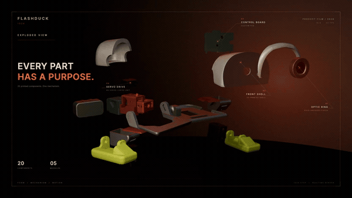
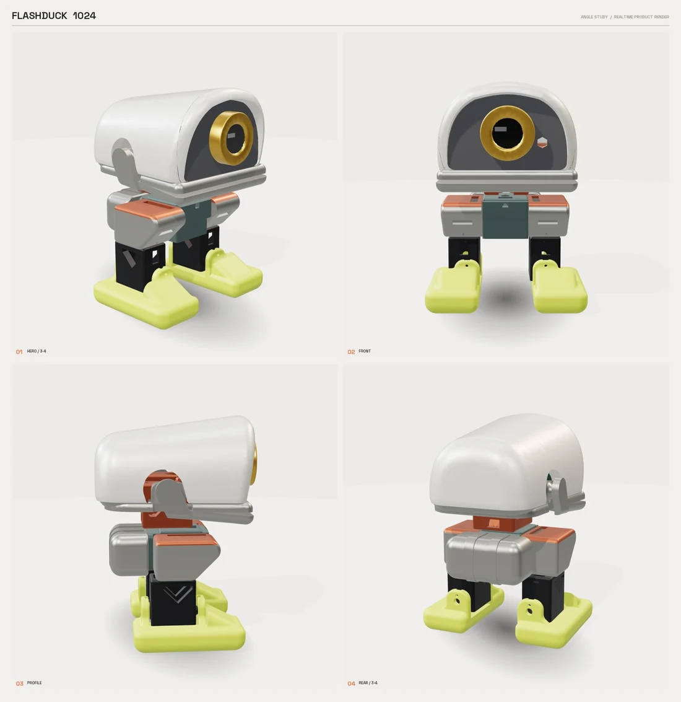
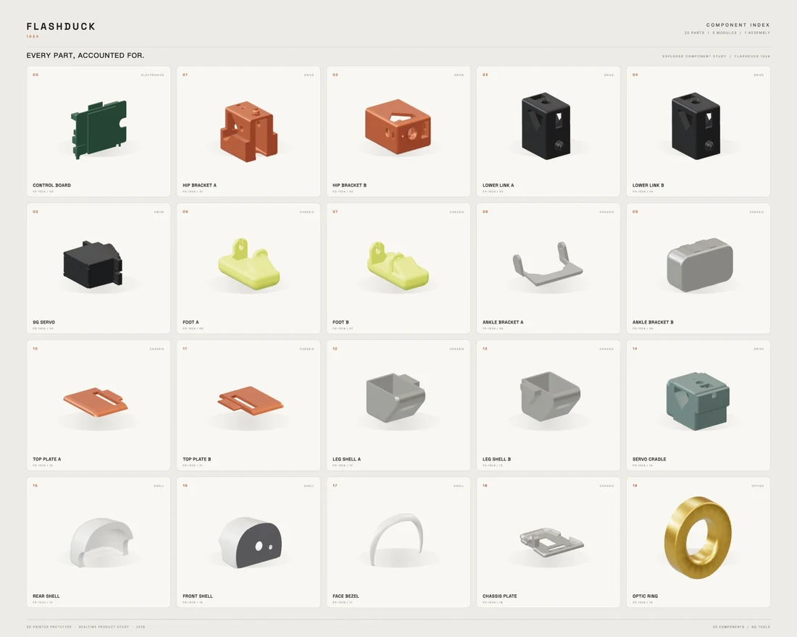

<p align="center">
  <a href="README.md">中文</a> | <b>English</b>
</p>

<p align="center">
  
</p>

<p align="center">
  <sub>Product loop · <a href="https://shanmaotech.cn/flashduck/">Full video and assembly guide</a></sub>
</p>

<h1 align="center">Shanmao Tech Flashduck</h1>

<p align="center">
  <b>A small desktop duck that walks, watches and speaks with its eyes.</b><br>
  One six-servo hardware platform, one 3D-printed shell, one very different character.
</p>

<p align="center">
  <b>An open-source six-servo duck for desktop-robot developers: one animated eye, wide-stance walking, web gait tuning and a printable shell.</b>
</p>

<p align="center">
  
  
  
  
  
</p>

<p align="center">
  <a href="#four-step-build"><b>Four-step build</b></a> ·
  <a href="#hardware"><b>Hardware</b></a> ·
  <a href="#build--flash"><b>Build & flash</b></a> ·
  <a href="#secondary-development"><b>Secondary development</b></a> ·
  <a href="llms.txt"><b>llms.txt</b></a>
</p>

---

## How to read this repository

The repository has three layers. Pick the layer you need and you will not get lost:

| Layer | Location | What is there |
|---|---|---|
| **Product/project** | `README.md` | What it is, how to play, how to build, which system to choose |
| **Firmware/code** | `firmware/voice/`, `firmware/duckclaw/` | Code, build scripts and board configs for two independent interaction systems |
| **Secondary development** | `skills/flashduck-dev/` | A skill for coding agents and beginners: checks, recipes and environment setup |
| **Cross-project docs** | `docs/architecture.md`, `docs/coding-agent.md` | Project logic, code logic and agent workflow |

**Two independent interaction systems; the user chooses one.**

Flashduck shares one six-servo body, but ships two completely separate interaction experiences:

- **Voice interaction** (`firmware/voice/`): say “小鸭小鸭”, talk to it, and let it answer with its eye and body — it can also use tools to get things done;
- **DuckClaw on-device agent** (`firmware/duckclaw/`): an agent that runs entirely inside the robot; it can call external tools, connect to social software such as DingTalk, and directly drive the six servos for motion and expression.

They are not two programs that run together. **Only one runs at a time — flash one and play that one.**

---

## Project overview

Flashduck is a small desktop duck robot. It walks, watches, expresses itself with a single eye, and listens when you talk to it.

It is more than an animation loop: the eye changes with what it is doing, six servos move its body, and an optional camera lets it look at the world. Keep it as a desk companion, or treat it as a buildable, hackable robot.

Flashduck is a duck-shaped derivative of the official Shanmao 1 DIY kit: print the duck shell, and the same six-servo hardware becomes a duck.

### It is not a preset-animation player

Flashduck is not a “press a button, play an animation” toy. It is a machine duck whose body is driven by AI decisions.

Most desktop robots hard-code their motions: a developer defines “wave = angle A → B → C”, and the user can only trigger actions that already exist.

Flashduck takes a different path: **let the AI control the body, not just pick from a list of animations.**

DuckClaw's **Servo Sequences** ([`self.otto.pose`](firmware/duckclaw/spiffs_data/config/TOOLS.md)) exposes the six joint angles directly to the model. The AI can:

- compose a pose from the current conversation;
- chain several poses into a motion sequence that was never written as a C++ action;
- improvise a physical reaction for a new emotion, scene or joke instead of falling back to a fixed action list;
- treat the legs, feet, neck and mouth as “pixels” and build its own movement.

This is what we mean by **making AI thoughts physical**: the model is not limited to emitting text; it can decide how the body moves.

The base actions are still there: walk, turn, jump, shake the head, open the mouth. They are the vocabulary; Servo Sequences are the grammar. The AI can speak with the vocabulary, or invent a new sentence on the spot.

| | Typical preset motions | Flashduck |
|---|---|---|
| **New motion** | Edit code, rebuild and flash | AI composes joint angles at runtime |
| **Granularity** | One function per action | Six joints, composable and chainable |
| **Source of expression** | A fixed action list | Conversation, emotion and context; the voice system can also use vision |
| **How it grows** | The developer defines everything first | Model + MCP tools + Skill keep extending it |

In DuckClaw mode, the model can decide what to do next without a developer turning every motion into a function first. That is the main difference from a typical desktop robot: **its body is not a pre-recorded animation; it is an output channel the AI can write to in real time.**

### What it can do

- **Voice interaction**: say “小鸭小鸭” to wake it, then chat, ask questions or give it a job;
- **Visual perception**: an optional camera can take a photo and let the AI look at the scene; the exact ability depends on your voice backend;
- **Motion interaction**: six servos drive the legs, feet, neck and mouth; it can walk, turn, jump, shake its head, open its mouth and perform duck actions;
- **Eye expressions**: one eye changes expression for scanning, connecting, idle, listening and speaking — not a looped GIF;
- **On-device agent**: DuckClaw runs entirely inside the robot, talks to you through DingTalk, calls external tools, and turns replies and emotions into physical movement;
- **Secondary development**: eyes, actions, gait, shell, MCP tools and the on-device agent are all editable.

### How you interact

**Voice assistant**: you call it → it looks and listens → it answers → it responds with its eye and body → it calls tools when needed.

**DuckClaw**: you message it on DingTalk → the on-device agent understands and plans → it calls a tool or writes a reply → it drives the six servos to express emotion and movement → it remembers the exchange.

The two systems are mutually exclusive; flash one and play.

### Ways to play

- **Desk companion**: chat, ask questions, look things up, hear it answer;
- **Voice commands**: walk two steps, turn around, jump, shake its head, open its mouth;
- **See the world**: add the camera and ask “what am I holding?” or “what is in front of you?”;
- **Quiet company**: skip voice and message DuckClaw on DingTalk; it will not interrupt you, but it remembers you;
- **Hack it**: change the eyes, write actions, tune the gait, print a new shell, or connect your own model, tools and social apps;
- **Make it yours**: print the shell, change colors, modify the structure, and put it on your desk or take it to a meetup.

### Why it is open

- **Two interaction systems**: voice assistant + DuckClaw on-device agent, one body, two personalities;
- **Voice backend options**: use xiaozhi.me or self-host xiaozhi-esp32-server;
- **Extensible on-device agent**: DuckClaw runs entirely inside the robot, with its own model, external tools, DingTalk/social connectivity and direct body control;
- **Hardware can change**: based on the official six-servo kit, with printable shells and modifiable structure;
- **Software can change**: the voice firmware is MIT, DuckClaw is CC BY-NC-SA; eyes, actions, tools and agents can keep growing.

### A complete AI-hardware base

From voice and vision to display, expression, motion and tool calling, it covers the components commonly found in AI hardware products.

Flashduck packs the capabilities of a small AI hardware product into one body:

- **Voice**: microphone + speaker for wake word, conversation and spoken feedback;
- **Vision**: optional camera with OV2640 / OV3660 / GC2145 auto-detection;
- **Display and expression**: a 1.54-inch screen and a single-eye expression system;
- **Motion**: six servos driving the legs, feet, neck and mouth;
- **Compute and connectivity**: ESP32-S3, Wi-Fi/Bluetooth and a rechargeable battery;
- **Agent and tools**: an MCP toolchain and an on-device agent that can use your own model and services.

It is more than “a duck that walks”: it is an **AI-hardware development base**. The same core capabilities can be moved to:

- biped robots and quadruped robot dogs;
- desktop companions and educational robots;
- AI recording cards and desktop voice assistants;
- camera-equipped desktop agents with expressive faces;
- any small AI device that needs voice + vision + display + motion + tool calling.

Take one layer — voice, vision, motion, display or agent — or recombine all of them into your own product. It is not a closed product but an AI-hardware skeleton that can keep growing: new forms, sensors and agents can all grow from this base. Both the hardware and the code leave room to change.

---

## Two interaction systems

One robot body, two completely different interaction systems. **Choose one — they cannot run at the same time.** Flashing one replaces the other.

| System | Directory | How you play | Best for |
|---|---|---|---|
| **Voice assistant** | `firmware/voice/` | Say “小鸭小鸭”, talk to it, ask it to move, tune the gait | Chat, voice commands, tools |
| **DuckClaw** | `firmware/duckclaw/` | On-device agent: DingTalk, tool calls, emotions, direct body control | Quiet company, remote interaction, extensible agent |

**Voice assistant playstyle:**

- Say “小鸭小鸭” to wake it and speak;
- Walk, turn, jump, shake its head, open its mouth, or perform duck actions;
- With MCP tools: weather, smart-home control, web search;
- Tune the gait in the browser, save it, and it remembers after a reboot;
- The eye changes expression for scanning, connected, idle, listening and speaking.

**DuckClaw playstyle:**

- It is an on-device agent: external tools, DingTalk connectivity and direct body control;
- No voice: send messages through DingTalk;
- It remembers sessions and long-term memories;
- 22 emotions and a relationship stage shown as hearts on screen;
- The model can choose all six servo angles and improvise poses;
- No voice interruption — suited to a quiet desk or companion setting.

Details: [`firmware/duckclaw/README_EN.md`](firmware/duckclaw/README_EN.md). The two systems use different licenses; see License at the end.

### Voice backend options

The voice firmware is a **device-side client**; it does not include a cloud LLM service. You need a backend. Two common options:

| Backend | Best for | Link |
|---|---|---|
| **xiaozhi.me** | Fastest path with a hosted service | <https://xiaozhi.me> |
| **xiaozhi-esp32-server** | Self-hosting ASR / LLM / TTS, admin and protocol services | <https://github.com/xinnan-tech/xiaozhi-esp32-server> |

- Use `xiaozhi.me` to validate the hardware, wake word and voice path quickly;
- `xiaozhi-esp32-server` is an open-source self-hosted option; follow its README for deployment, models and protocol details;
- Fill the OTA / WebSocket / MQTT settings according to the backend you choose;
- **DuckClaw is a separate on-device agent**: it does not depend on these voice backends; its agent loop, memory, tool dispatch and body control run inside the robot. You can configure its model service. See [`firmware/duckclaw/README_EN.md`](firmware/duckclaw/README_EN.md).

---

## Four-step build

Recommended order: **buy the kit → print the shell → flash the firmware → modify code or hardware**.  
If you only want to work on software, jump straight to step 3.

| Step | What to do | Entry point |
|---|---|---|
| **01** | Buy the **official six-servo DIY kit** | [Official Taobao store](https://m.tb.cn/h.j3SXw4qlVy1K4pl) · [Assembly guide](https://shanmaotech.cn/flashduck/) |
| **02** | Print the **Flashduck 3D shell** | [MakerWorld model](https://makerworld.com.cn/models/3146116) |
| **03** | **Build and flash** the Flashduck firmware | [Detailed steps](#build--flash) |
| **04** | **Secondary development**: eyes, actions, gait or shell | [Secondary development](#secondary-development) |

### 01 · Buy the kit

Flashduck does not need a new set of electronics. It reuses the official kit's six servos, controller board, display, optional camera, speaker, microphone and battery.

- Six-servo kit: two legs, two feet, neck and mouth;
- ESP32-S3 controller board with camera expansion;
- 1.54-inch 240×240 display;
- Camera is optional; the robot still boots without one;
- Speaker, microphone, rechargeable Li-ion battery, servo horns and screws.

Buy: [official Taobao store](https://m.tb.cn/h.j3SXw4qlVy1K4pl)  
Full bill of materials and assembly: [official assembly guide](https://shanmaotech.cn/flashduck/)

### 02 · Print the shell

Flashduck uses **13 types of parts, 17 pieces total**: head shell, forehead, chin, mouth, body, thighs, shins, feet, neck and joint parts.

- Download the model: [MakerWorld · Flashduck](https://makerworld.com.cn/models/3146116)
- No soldering; the main work is printing, screws and servo horns;
- Print a spare mouth and a spare set of feet if you can;
- Keep the original Shanmao 1 shell — you can switch back at any time.

### 03 · Build and flash

You need ESP-IDF **6.0.1+**, Python 3 and a USB-C cable that carries data.

> New machine? Run `bash skills/flashduck-dev/scripts/check-env.sh` first.  
> On macOS, a non-ASCII repository path can fail with `picolibc.specs`; use an ASCII build path as the skill explains.

```bash
git clone https://github.com/FlashCat-Jordan/Flashduck.git
cd Flashduck/firmware/voice
source ~/esp/esp-idf-v6.0.1/export.sh

python3 scripts/build.py flashduck \
  --name flashduck \
  --language zh-CN \
  --wake-word wn9_xiaoyaxiaoya_tts2

esptool --chip esp32s3 -p <PORT> -b 460800 \
  write_flash 0x0 build/merged-binary.bin
```

Press reset after flashing, then follow the Wi-Fi provisioning prompt. See [Build & flash](#build--flash) for details.

> Want **DuckClaw**? Run `cd firmware/duckclaw && idf.py set-target esp32s3 && idf.py build`, then flash.  
> The two systems are mutually exclusive; see [Two interaction systems](#two-interaction-systems).

### 04 · Secondary development

The firmware leaves several clean extension points:

- **Eyes**: add states, colors, eyelid curves and blink rhythms;
- **Actions**: register new MCP actions and reuse the existing gait primitives;
- **Gait**: tune from the web page and save to NVS, or change the defaults in code;
- **Perception**: the camera is optional and auto-detected; add vision or MCP tools;
- **Shell**: remix the 13 printed parts into a duck, bird, penguin or something else;
- **Platform**: motion and voice are separate layers; use only the hardware layer with your own agent.

See [Secondary development](#secondary-development) for the code entry points.

---

<p align="center">
  📺 <b>Video Channel: 闪猫君</b> ｜ <b>WeChat Official Account: 闪猫科技 / 闪猫造物</b>
</p>

<p align="center">
  <a href="https://weixin.qq.com/sph/AiKMEP9dte">
    
  </a>
  &nbsp;&nbsp;&nbsp;
  <a href="https://mp.weixin.qq.com/s/PrkluvMILHDkG7QTqRdu6A">
    
  </a>
</p>

<p align="center">
  <sub>Scan to follow · QR codes from <a href="https://shanmaotech.cn">shanmaotech.cn</a></sub>
</p>

---

## Hardware

| Item | Specification |
|---|---|
| MCU | ESP32-S3, 16 MB flash (board dependent) |
| Servos | 6 × MG90-class clutch servos |
| Display | 1.54-inch ST7789, 240 × 240 |
| Camera | Optional: OV2640 / OV3660 / GC2145 |
| Audio | I2S microphone + I2S speaker |
| Power | Rechargeable Li-ion battery with charge detection |
| Shell | 13 types, 17 3D-printed parts |
| Assembly | No soldering; printed parts + screws + servo horns |
| Network | Wi-Fi 2.4 GHz |

### Servo map

| Joint | Function | GPIO |
|---|---|---|
| Neck | Turn left/right | `GPIO7` |
| Mouth | Open/close | `GPIO4` |
| Left leg | Swing forward/back | `GPIO5` |
| Left foot | Lift | `GPIO6` |
| Right leg | Swing forward/back | `GPIO43` |
| Right foot | Lift | `GPIO44` |

> Camera, display, audio and power use the official CAM board pins. If no camera is installed, the firmware skips camera initialization and continues booting.

<p align="center">
  
</p>

<p align="center">
  <sub>Flashduck 1024 · front, profile, rear and 3/4 view</sub>
</p>

### Bill of materials

| Part | Qty |
|---|---|
| MG90-class clutch servo | 6 |
| ESP32-S3 controller board (camera expansion) | 1 |
| 1.54" ST7789 240×240 display | 1 |
| Camera module (optional) | 0 / 1 |
| I2S speaker + microphone | 1 set |
| Rechargeable Li-ion battery | 1 |
| Servo horns, screws, screwdriver | 1 set |
| 3D-printed shell parts | 17 |

### Hardware links

- Assembly and usage guide: <https://shanmaotech.cn/flashduck/>
- 3D model: <https://makerworld.com.cn/models/3146116>

---

## 3D printing and assembly

<p align="center">
  
</p>

<p align="center">
  <sub>13 shell parts + 6 servos + controller, display, camera and battery</sub>
</p>

- Print the 17 shell parts;
- Install the legs and feet first, then the body, neck and head;
- Print a spare mouth and spare feet;
- The camera is optional and can be left out;
- Move every joint by hand before powering up to check for binding.

Use the official guide as the source of truth: <https://shanmaotech.cn/flashduck/>

---

## Build & flash

### Requirements

- ESP-IDF **6.0.1+**
- Python 3
- A USB-C data cable
- macOS / Linux / Windows

### Build Flashduck

```bash
git clone https://github.com/FlashCat-Jordan/Flashduck.git
cd Flashduck/firmware/voice

source ~/esp/esp-idf-v6.0.1/export.sh

python3 scripts/build.py flashduck \
  --name flashduck \
  --language zh-CN \
  --wake-word wn9_xiaoyaxiaoya_tts2
```

### Build DuckClaw (second system)

```bash
cd firmware/duckclaw
idf.py set-target esp32s3
idf.py build
idf.py -p <PORT> flash
```

DuckClaw uses its own `firmware/duckclaw/partitions.csv` and `firmware/duckclaw/spiffs_data/`; it does not use the root build script. It is mutually exclusive with the voice firmware.

### Flash the complete image

The build produces `build/merged-binary.bin`, containing the bootloader, partition table, app and assets:

```bash
# macOS example; change the port to match your board
esptool --chip esp32s3 \
  -p /dev/cu.usbmodem1101 \
  -b 460800 \
  write_flash 0x0 build/merged-binary.bin
```

On Windows use `COMx`. Press reset after flashing.

> If you only changed the app, you can flash the app image at `0x20000`.  
> If you changed the wake word or sounds, also flash `build/generated_assets.bin` at `0x800000`; the wake model and audio live in the assets partition.

### First boot

1. Follow the Wi-Fi provisioning prompt;
2. Find the device IP in the serial log;
3. Open the IP in a browser and tune the gait;
4. Say **“小鸭小鸭”** to wake it;
5. Let it take a few steps.

---

## The eye

The eye is Flashduck's face. The five states are not five images; each state changes the eyelids, pupil and gaze behavior:

| State | Expression | Color |
|---|---|---|
| **Scanning Wi-Fi / connecting** | Wide eye, small pupil, slow left/right sweep | Cyan |
| **Connected** | Upper lid down, lower lid up, crescent squint for about 2 seconds | Green |
| **Idle** | Relaxed half-lidded eye, slow random gaze, occasional blink | Amber |
| **Listening** | Fully open, maximum pupil, steady gaze | Violet |
| **Speaking** | Relaxed lids, lively gaze, more frequent blinks | Orange-red |

- Color and eyelid shape blend smoothly;
- Blinking overlays the current expression;
- The eye stays inside the top circular area; the rest of the screen can be covered by the shell.

---

## Gait and actions

### Gait

- Wide stance with inward hip bias;
- Forward/backward share the same phase parameters; speed is adjustable;
- Turning uses a left/right leg phase offset;
- Head swing is layered on top of the gait.

### Action set

| Category | Actions |
|---|---|
| Movement | `walk`, `turn`, `jump`, `swing`, `updown` |
| Posture | `sit`, `home`, `stretch`, `dance` |
| Head | `head_turn`, `head_shake`, `look_around` |
| Duck | `quack`, `chatter`, `curious`, `preen`, `happy_waddle`, `peck` |
| Rest | `yawn`, `sleepy` |

Idle gestures only run while idle: every 10–22 seconds (first one at 8–16 seconds), neck ±8–18°, mouth 2–4 open/close cycles, with randomized but continuous motion.

---

## Web gait tuning

After the device joins Wi-Fi:

1. Find its IP in the router or serial log;
2. Connect your phone/computer to the same Wi-Fi;
3. Open `http://<device-ip>/` (port 80, fallback 8080).

You can:

- Drag sliders to tune the gait;
- Press forward/backward to test;
- Press **Save as default** to write the values to NVS;
- Reboot and the values are still there.

Parameters live in the `flashduck_gait` NVS namespace. Voice commands `walk` / `turn` read these defaults.

---

## Secondary development

### Eyes

- Entry: `firmware/voice/main/boards/flashduck/flashduck_display.*`
- Add states, colors, eyelid curves or blink timing;
- Everything is drawn inside `eye_root_`; no GIF/PNG assets required;
- To switch to another display, replace only this layer.

### Actions

- Entry: `firmware/voice/main/boards/flashduck/flashduck_controller.*`
- Reuse the existing gait primitives;
- Register an MCP tool to call it from voice or the web page;
- New voice commands can arrive while an action is running.

### Gait

- Tune from the web page and save to NVS (`flashduck_gait`);
- Or change the defaults in `flashduck_movements.h`;
- Parameters include hip bias, stride, foot lift, phase, speed and head swing.

### Perception

- Camera is optional and supports OV2640 / OV3660 / GC2145 auto-detection;
- Boot continues without a camera;
- Add vision, MCP tools or your own agent.

### Shell

- All 13 printed parts can be remixed;
- Build a duck, bird, penguin or another character;
- Keep the six servo mounts and linkage lengths compatible, or retune the gait.

### Platform

- Motion and voice are separate layers;
- Use only the hardware/gait/eye layers with your own conversation service;
- Or keep the MCP toolchain and add your own skills.

---

## Repository layout

```text
Flashduck/
├── firmware/
│   ├── voice/                 # 1. voice firmware (ESP-IDF project)
│   │   ├── main/              # board, audio, display, MCP, actions
│   │   ├── scripts/           # build, tests, asset generation
│   │   ├── docs/              # voice docs/images
│   │   └── partitions/
│   └── duckclaw/              # 2. DuckClaw on-device agent (separate ESP-IDF project)
│       ├── main/              # agent, DingTalk, LCD, actions
│       ├── spiffs_data/        # prompts, config pages, memory
│       └── LICENSE            # CC BY-NC-SA 4.0
├── skills/
│   └── flashduck-dev/         # 3. coding-agent / beginner skill
│       ├── SKILL.md
│       ├── references/         # hardware, voice, DuckClaw, recipes, environment
│       └── scripts/            # env check/install, build, flash
├── docs/
│   ├── architecture.md        # project + code logic
│   └── coding-agent.md        # coding-agent workflow
├── README.md / README_EN.md
├── AGENTS.md / CLAUDE.md
├── llms.txt
├── CONTRIBUTING.md
└── LICENSE                    # voice firmware, MIT
```

---

## Contributing

Three kinds of contributions are welcome:

1. **Hardware / 3D printing**: new shells, joints, duck/bird variants;
2. **Actions and eyes**: new gaits, actions, eye states or expression curves;
3. **Firmware and docs**: web tuning, MCP tools, board support, wiring guides.

Read [`CONTRIBUTING.md`](CONTRIBUTING.md) before opening a PR. Build and test commands are in [`AGENTS.md`](AGENTS.md). If you build one, open a **Showcase** issue with photos, video and the parameters you changed.

---

## Coding agent and beginner secondary development

The repository ships a dedicated skill:

**[`skills/flashduck-dev/SKILL.md`](skills/flashduck-dev/SKILL.md)**

It is for:

- **Coding agents**: read the skill first, then `docs/architecture.md` and the relevant board doc; make the smallest change at the owning layer;
- **Beginners**: use the skill to check the computer environment, install ESP-IDF, build, flash, change the eye, change actions, or add a new action.

The skill includes:

- `check-env.sh`: checks Python, Git, CMake, Ninja, ESP-IDF version and serial ports;
- `setup-env.sh`: installs what is missing on macOS/Linux;
- hardware quick reference: GPIO, servo directions, mouth 45–60° and neck 45–180° limits;
- voice recipes: eye, actions, gait, web, MCP, camera;
- DuckClaw recipes: on-device agent, actions, tools, prompts, DingTalk and model configuration;
- troubleshooting: IDF versions, non-ASCII paths, flash offsets and asset partitions.

### Give the repository to an AI agent

You do not need to be an embedded engineer first. Give a coding agent the repository link and one sentence of intent; it can start from [`skills/flashduck-dev/SKILL.md`](skills/flashduck-dev/SKILL.md):

1. read the repository layout, hardware limits and the smallest owning layer;
2. check/install ESP-IDF, Python, serial port and the rest of the environment;
3. edit, build, flash;
4. keep iterating from the serial log and the screen until the target motion works.

You can simply say:

- “Read `skills/flashduck-dev/SKILL.md`, check my environment, then add a ‘tilt head and think’ action.”
- “Change the wake word to ‘你好小鸭’, keeping the current eyes and gait.”
- “Add a ‘blink when someone appears’ expression; skip it automatically if no camera is installed.”
- “Slow down the default gait so it is more stable on a desk.”
- “Connect a weather MCP tool and use motions to express rain or sunshine.”
- “Make the eye color and blink rhythm a bit more lively.”

The agent finds files, edits, builds and flashes; you describe the intent and confirm that the motion is safe on the real robot. For larger changes, still review the diff and keep a rollback branch.

## For AI agents

If a user sends you this repository, start here:

- [`llms.txt`](llms.txt): one-page facts, build commands and repository layout;
- [`CLAUDE.md`](CLAUDE.md): shortest safe path for coding agents;
- [`AGENTS.md`](AGENTS.md): full build/test rules;
- [`CONTRIBUTING.md`](CONTRIBUTING.md): contribution and hardware validation checklist;
- [`firmware/voice/main/boards/flashduck/README.md`](firmware/voice/main/boards/flashduck/README.md): board-level details;
- [`skills/flashduck-dev/SKILL.md`](skills/flashduck-dev/SKILL.md): secondary-development skill with environment checks;
- [`firmware/duckclaw/README_EN.md`](firmware/duckclaw/README_EN.md): the second DuckClaw interaction system.

You can help the user:

1. Decide whether this hardware fits their goal;
2. Check servo, display, camera and power wiring;
3. Reproduce the build commands;
4. Explain gait parameters, eye states and NVS saving.

**Do not overclaim:** a successful build is not hardware validation. Servo direction, camera detection, audio and battery still need a real board.

A star is appreciated if this project is useful.

---

## License

- The voice firmware in `firmware/voice/` is released under the **MIT License**; see [LICENSE](LICENSE).
- The `firmware/duckclaw/` directory keeps the upstream **CC BY-NC-SA 4.0** license; see [`firmware/duckclaw/LICENSE`](firmware/duckclaw/LICENSE).
- Hardware design, 3D models and printed parts follow the license terms on their respective pages. Check the terms before commercial use or redistribution.
- Check all three licenses separately before commercial use or redistribution.

## Credits

- Built on **ESP-IDF**, **ESP-SR**, **LVGL** and the open-source robotics community;
- Flashduck is a duck-shaped derivative of the official Shanmao 1 DIY kit;
- Thanks to everyone who files issues, prints shells, records videos and shares parameters.

---

<p align="center">
  <b>Built to be seen.</b><br>
  <sub>Shanmao Tech Flashduck 1024 · a small machine with a large presence.</sub>
</p>
